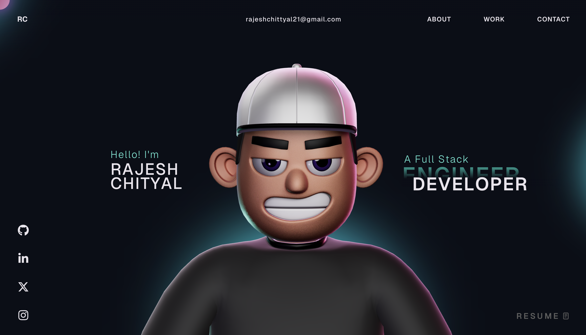

# Dhruvil Portfolio Website 🚀

This repository contains the open-source code for my personal portfolio website.

It is built with a modern frontend stack focused on animation and 3D interaction.

**Tech Stack:** React, TypeScript, Vite, GSAP, Three.js, React Three Fiber, WebGL, CSS



## Quick Start 🛠️

### 1) Prerequisites

Make sure you have:

- **Node.js** 18+ (recommended: latest LTS)
- **npm** 9+
- A modern browser (Chrome/Edge/Firefox)

### 2) Install dependencies

```bash
npm install
```

### 3) Run in development mode

```bash
npm run dev
```

This starts the Vite dev server (configured with `--host`) and prints a local URL.

### 4) Build for production

```bash
npm run build
```

The production-ready output is generated inside the `dist/` folder.

### 5) Preview production build locally

```bash
npm run preview
```

## Development Guide 👨‍💻

### Available scripts

- `npm run dev` → Start local development server
- `npm run build` → Create optimized production build
- `npm run preview` → Preview production build locally
- `npm run lint` → Run ESLint checks

### Recommended development workflow

1. Create a new branch for your feature/fix.
2. Run `npm run dev` and keep it open while developing.
3. Make small component-level changes.
4. Run `npm run lint` regularly.
5. Run `npm run build` before pushing.
6. Commit with clear messages.

### Project structure (important folders)

- `src/components/` → Main UI and section components (`About`, `Work`, `Contact`, etc.)
- `src/components/Character/` → 3D character scene and helper utilities
- `src/components/styles/` → Component-specific CSS files
- `src/context/` → Shared app state/providers (e.g., loading state)
- `src/data/` → Static data/configuration for rendering and animation
- `public/models/` → Encrypted/processed model and HDR assets
- `public/draco/` → Draco decoder files used for compressed 3D assets
- `public/images/` → Static images used by the site

### Where to edit what

- Update section text/content in component files inside `src/components/`.
- Adjust animation behavior in:
	- `src/components/utils/`
	- `src/components/Character/utils/`
- Update visuals and spacing in `src/components/styles/` and `src/App.css`.
- Replace media assets in `public/images/` and 3D assets in `public/models/`.

### 3D + animation notes

- This project uses Three.js + React Three Fiber for 3D rendering.
- Draco decoder files are already included under `public/draco/`.
- Character/model logic lives in `src/components/Character/Scene.tsx` and related utils.
- If you update model files, validate paths and loading behavior before committing.

### GSAP plugin note (important)

This project currently uses modified/trial setup for GSAP Club plugins.

> Trial plugins are **not allowed for production hosting**.

If you plan to deploy publicly, install properly licensed Club plugins as documented by GSAP:
https://gsap.com/docs/v3/Installation/

## Deployment Notes 🌐

Before deployment:

- Run `npm run lint`
- Run `npm run build`
- Test `npm run preview`
- Verify that any GSAP Club plugin usage is production-compliant

You can deploy the `dist/` output to platforms like Vercel, Netlify, GitHub Pages (with proper SPA routing setup), or any static hosting provider.

## Contributing

Contributions, suggestions, and improvements are welcome.

If you open a PR, please keep changes focused and include a short description of what was improved.

## License

This project is open source and available under the [MIT License](LICENSE).
